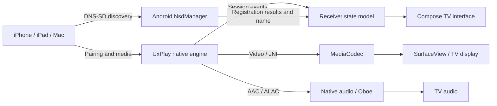

# How the Android TV receiver works

This describes the current source behavior. Build and host test results are not proof of physical Apple–TV connectivity; see [the test report](../TEST_REPORT.md).

## Connection path

[MainActivity](../app/src/main/kotlin/io/github/jqssun/airplay/MainActivity.kt) binds the visible UI to [AirPlayService](../app/src/main/kotlin/io/github/jqssun/airplay/service/AirPlayService.kt). The service watches Wi-Fi/Ethernet events and manages the native listener and `_airplay._tcp` / `_raop._tcp` advertisements. Validated internet access is not required for local mirroring; external direct-video sources may need internet.

[NsdServiceManager](../app/src/main/kotlin/io/github/jqssun/airplay/discovery/NsdServiceManager.kt) reports registration results. The UI becomes ready only after the listener and both service advertisements succeed. The actual registered AirPlay name is displayed after a name collision.

## PIN and sessions

[Prefs.DEF_REQUIRE_PIN](../app/src/main/kotlin/io/github/jqssun/airplay/Prefs.kt) is `true`. Both the service and settings UI default to PIN enabled when no saved preference exists. A user may explicitly disable it; connection-related settings apply to the next session.

[The native bridge](../app/src/main/cpp/native_bridge.cpp) passes this setting to the engine. Random PIN generation failure aborts startup; there is no `1234` fallback. Patched UxPlay [pairing](../app/src/main/cpp/third_party/UxPlay/lib/pairing.c), [SRP](../app/src/main/cpp/third_party/UxPlay/lib/srp.c) and [RAOP](../app/src/main/cpp/third_party/UxPlay/lib/raop.c) paths reject invalid/out-of-order pairing and unverified media setup. Displaying a PIN is not itself authentication.

Displaying a PIN starts a 90-second timeout; early connection setup uses shorter 30- or 15-second timeouts. [ReceiverStateMachine](../app/src/main/kotlin/io/github/jqssun/airplay/SalonState.kt) changes its generation on start/stop; callbacks from an earlier generation cannot change the new UI state. Ending a session clears its displayed PIN. Physical wrong-PIN and cancellation flows remain untested.

The single-source rule uses an authenticated or media-established RAOP session, not TCP connection count. Additional channels from the same source are allowed; a different source cannot take over active media. With PIN enabled, direct video also requires an authenticated matching source.

## Media

[VideoQuality](../app/src/main/kotlin/io/github/jqssun/airplay/VideoQuality.kt) orders profiles. [DecoderSelector](../app/src/main/kotlin/io/github/jqssun/airplay/renderer/DecoderSelector.kt) and [VideoRenderer](../app/src/main/kotlin/io/github/jqssun/airplay/renderer/VideoRenderer.kt) check device capacity. 4K requires hardware HEVC; 1080p/60 requires suitable hardware H.264. Unsupported targets fall back to lower H.264 profiles; no supported target fails startup. Software decoding is capped at 720p/30.

Mirroring uses MediaCodec and EGL with [SurfaceView](../app/src/main/kotlin/io/github/jqssun/airplay/ui/VideoSurfaceView.kt). The buffer follows the received video dimensions, up to 3840 pixels per edge; orientation and aspect ratio are preserved in the layout. Actual TV rendering is not visually verified.

AAC/ALAC audio uses the native decoder and Oboe engine. The TV remote controls volume. Direct video/HLS uses [AirPlayVideoPlayer](../app/src/main/kotlin/io/github/jqssun/airplay/renderer/AirPlayVideoPlayer.kt) and Media3 separately. Successful mirroring does not establish HLS or audio-only compatibility.

## Lifecycle and storage

Leaving with HOME stops the receiver; returning starts it. Configuration changes and transient system settings are handled separately. There is no foreground service, overlay, boot auto-start or media recording.

TV name, PIN preference and quality are stored in private SharedPreferences. Pairing client keys live in server memory; restarting may require pairing again. Diagnostics are bounded and sensitive content is filtered. The PIN mechanism is designed for local-network use, not internet exposure.

The displayed application name is functional. Package ID `app.salon.receiver`, internal class names and upstream JNI package `io.github.jqssun.airplay` remain for compatibility. Existing saved TV names survive an update. Native pins and licensing are documented in [UPSTREAM.md](../UPSTREAM.md).
