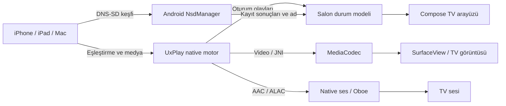

# Salon nasıl çalışır?

Bu belge 1.0.1 uygulamasının kaynak davranışını açıklar. Derleme ve birim testleri, gerçek Apple cihazı ile TV bağlantısının çalıştığına dair kanıt değildir; cihaz kontrollerinin durumu [test raporunda](../TEST_REPORT.md) bulunur.

## Bağlantı yolu

[MainActivity](../app/src/main/kotlin/io/github/jqssun/airplay/MainActivity.kt), görünür uygulamayı [AirPlayService](../app/src/main/kotlin/io/github/jqssun/airplay/service/AirPlayService.kt) ile bağlar. Servis Wi-Fi/Ethernet olaylarını izler, native dinleyiciyi ve `_airplay._tcp` / `_raop._tcp` ilanlarını yönetir. Ağın internet tarafından doğrulanmış olması, yerel ekran yansıtma için bağlantı şartı değildir. Doğrudan internet video kaynakları ayrıca internet gerektirebilir.

[NsdServiceManager](../app/src/main/kotlin/io/github/jqssun/airplay/discovery/NsdServiceManager.kt) kayıt sonuçlarını bildirir. Dinleyici ve iki servis ilanı hazır olmadan UI “hazır” olmaz. İsim çakışmasında Android’in gerçekten kaydettiği AirPlay adı gösterilir; gönderici listesinde bu ad seçilmelidir.

## PIN ve oturum

[Prefs.DEF_REQUIRE_PIN](../app/src/main/kotlin/io/github/jqssun/airplay/Prefs.kt) `true`’dur. Servis ve ayarlar ekranı da kayıtlı bir tercih yoksa PIN’i açık kabul eder. Kullanıcı Ayarlar’dan kapatabilir; mevcut yayın sırasında değişiklik sonraki oturumda uygulanır.

[Native bridge](../app/src/main/cpp/native_bridge.cpp) bu tercihi native motora geçirir. PIN açıkken rastgele kod oluşturulur; üretim başarısızsa native başlangıç başarısız olur. Sabit `1234` fallback’i yoktur. UxPlay’in yamalı [pairing](../app/src/main/cpp/third_party/UxPlay/lib/pairing.c), [SRP](../app/src/main/cpp/third_party/UxPlay/lib/srp.c) ve [RAOP](../app/src/main/cpp/third_party/UxPlay/lib/raop.c) yolları bozuk veya sırası yanlış eşleştirmeyi ve doğrulanmamış medya kurulumunu reddeder. Kod gösterilmesi tek başına doğrulanmış bağlantı anlamına gelmez.

PIN / bağlantı aşamasında 90 saniyelik kontrollü zaman aşımı uygulanır. [ReceiverStateMachine](../app/src/main/kotlin/io/github/jqssun/airplay/SalonState.kt), her başlangıç/durdurma için nesil numarası kullanır. Önceki oturumdan geç gelen callback’ler yeni UI durumunu değiştiremez. Oturum bitince gösterilen PIN temizlenir. Bunlar kaynak ve otomatik test davranışlarıdır; gerçek Apple yanlış-PIN / iptal akışı cihazda test edilmemiştir.

Tek aktif kaynak, doğrulanmış veya medya kurulumu yapılmış RAOP oturumuyla belirlenir. TCP bağlantı sayısı cihaz sayısı değildir; aynı kaynağın protokol kanalları olabilir. İkinci kaynak aktif yayını devralamaz. Doğrudan video yolu da PIN açıkken doğrulanmış aynı kaynak ister.

## Görüntü ve ses

[VideoQuality](../app/src/main/kotlin/io/github/jqssun/airplay/VideoQuality.kt) istenen profilleri sıralar; [DecoderSelector](../app/src/main/kotlin/io/github/jqssun/airplay/renderer/DecoderSelector.kt) ve [VideoRenderer](../app/src/main/kotlin/io/github/jqssun/airplay/renderer/VideoRenderer.kt) cihaz kapasitesine göre seçim yapar. 4K için donanım HEVC, 1080p/60 için uygun donanım H.264 gerekir. Destek yetersizse daha düşük H.264 profiller denenir; hiçbir uygun profil yoksa başlangıç hata verir. Yazılım decoder’ı en fazla 720p/30 ile sınırlıdır.

Yansıtma videosu MediaCodec ve EGL yolundan [SurfaceView](../app/src/main/kotlin/io/github/jqssun/airplay/ui/VideoSurfaceView.kt) üzerine gider. Video tamponu gelen boyuta göre, kenar başına en fazla 3840 piksel olacak şekilde ayarlanır. Oran ve dikey/yatay değişim korunur; gerçek TV üzerinde görsel doğrulama yapılmamıştır.

AAC ve ALAC yolları korunur; ses native decoder / Oboe motorundan çıkar. Ses seviyesini TV kumandasından ayarlayın. Doğrudan video/HLS, [AirPlayVideoPlayer](../app/src/main/kotlin/io/github/jqssun/airplay/renderer/AirPlayVideoPlayer.kt) ve Media3 üzerinden ayrı işler. Mirroring, HLS ve yalnızca ses birbirinin çalışma kanıtı değildir.

## Yaşam döngüsü ve veri

HOME ile başka uygulamaya geçilince alıcı durur. Salon yeniden görünür olunca başlatılır; yapılandırma değişiklikleri ve geçici sistem ayarları ayrı ele alınır. Foreground service, overlay, açılışta otomatik alıcı ve medya kaydı yoktur.

TV adı, PIN tercihi ve kalite uygulama özel SharedPreferences içinde tutulur. Eşleştirme istemci anahtarları sunucunun belleğindedir; sunucu yeniden açılınca yeniden eşleştirme gerekebilir. Teknik kayıtlar sınırlandırılır ve hassas içerikler filtrelenir. Bu PIN mekanizması, yerel ağı internete açmak için tasarlanmış bir kimlik sistemi değildir.

JNI sınıf adları upstream ile uyumlu bırakılmıştır; uygulamanın Android kimliği `app.salon.receiver` olsa da Kotlin paketleri `io.github.jqssun.airplay` olarak kalır. Native kaynaklar ve lisanslar depoda sabitlenmiştir. Ayrıntılı sürüm kaydı [UPSTREAM.md](../UPSTREAM.md)’dedir.
